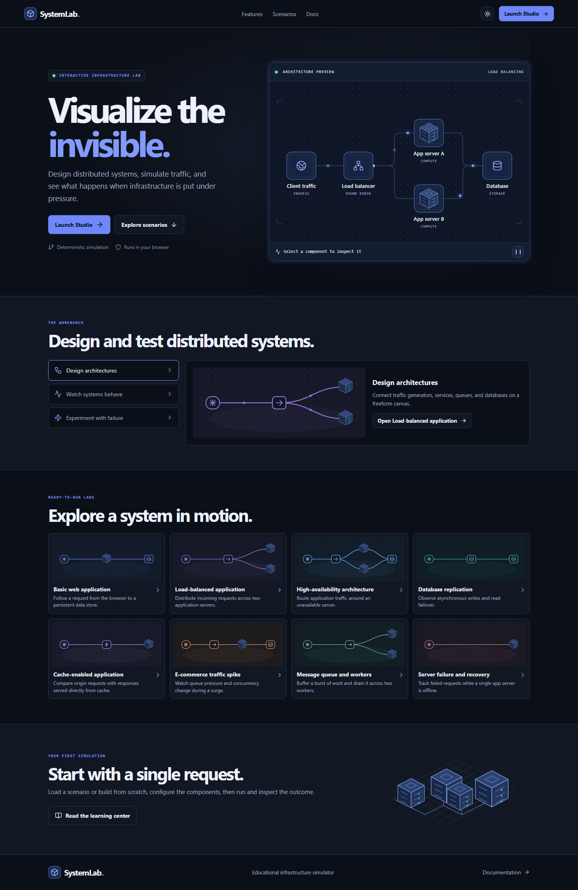
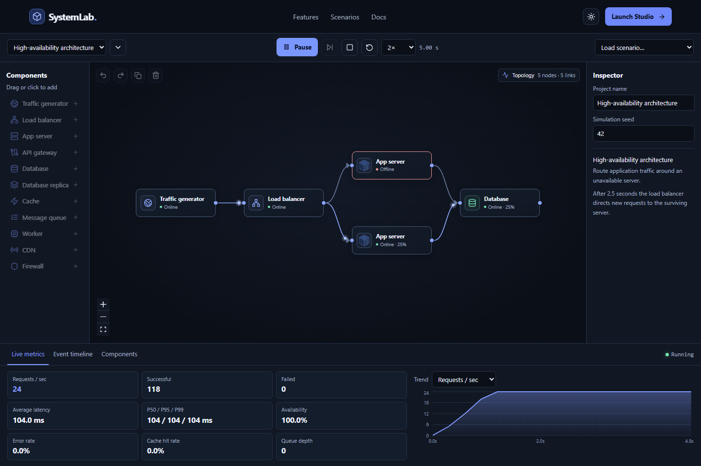
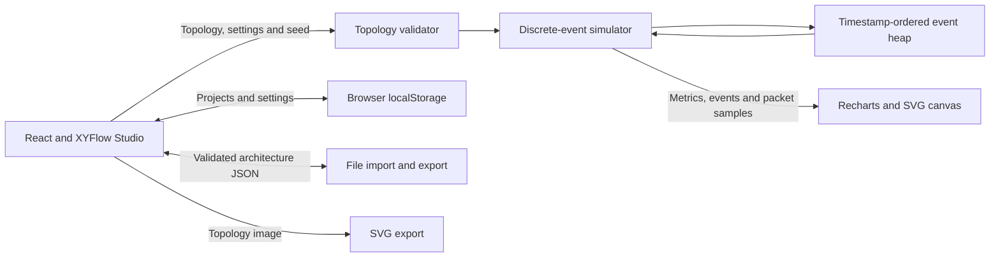

# SystemLab

SystemLab is a browser-based cloud architecture simulator. Build a topology, send repeatable traffic through it, and inspect how latency, throughput, queues, and availability change as components fail or recover.

[Architecture decisions](ARCHITECTURE.md) · [Verification report](TEST-REPORT.md) · [Portfolio and interview guide](PORTFOLIO.md)

## Features

- Edit a topology of 11 component types with drag-and-drop, connection handles, an inspector, and undo and redo.
- Run, pause, step, and reset a seeded discrete-event simulation. Follow packets and inspect live charts, component state, and the event timeline.
- Compare round robin and least connections. Experiment with rate limits, autoscaling, cache hits, failover, and asynchronous replication.
- Save projects in the browser. Import and export architecture JSON or export the topology as a standalone SVG.

## Screenshots





The [scenario screenshots](screenshots/final/) cover basic web requests, load balancing, high availability, database replication, caching, an e-commerce traffic spike, message queues and workers, and server failure and recovery.

## Architecture



**Stack** · React, TypeScript, Vite, XYFlow, Recharts, Tailwind CSS, Lucide, Vitest, and Playwright. The built app serves static assets and runs entirely in the browser.

## Run locally

Use Node.js 24 to match the GitHub Actions environment.

```sh
npm ci
npm start
```

Open [http://localhost:5173/](http://localhost:5173/) and select **Launch Studio**. Start the default high-availability scenario and watch the load balancer continue routing traffic after an app server goes offline.

## Production preview and verification

```sh
npm run lint
npm test
npm run build
npx playwright install chromium
npm run test:browser
npm run preview
```

The production preview starts at [http://localhost:4173/systemlab/](http://localhost:4173/systemlab/). Open [Studio directly](http://localhost:4173/systemlab/#studio) or reload that address to test fragment routing. Playwright starts its own preview server, so run browser tests before starting the standalone preview.

Release verification passed 23 Vitest checks, 15 Chromium checks, ESLint, and the TypeScript production build. All eight scenarios ran under the production subpath. See the [verification report](TEST-REPORT.md) for scope and the scenario checks.

## Publish on GitHub Pages

Create a **public** GitHub repository named `systemlab`, enable **GitHub Actions** under **Settings → Pages**, and push `main`. If the first push ran before Pages was enabled, manually run **Verify and deploy SystemLab** from the Actions tab. The workflow runs lint, unit tests, TypeScript, the production build, and Chromium tests before uploading `dist/`. It exposes the actual published URL in the deployment job.

Vite sets `/systemlab/` as the production and preview base. Studio and Docs use fragments such as `#studio` and `#docs`, so their direct links and reloads resolve through the same static HTML file. GitHub Pages supports public repositories on GitHub Free. SystemLab uses no custom domain, external server, or user-provided credentials. [GitHub Pages workflow guide](https://docs.github.com/en/pages/getting-started-with-github-pages/using-custom-workflows-with-github-pages)

To repeat the browser suite against a live site, set `SYSTEMLAB_TEST_URL` to the published site’s full base URL, including the trailing slash, and run `npm run test:browser`. This runs in an isolated Chromium session and exercises browser-local project storage.

## Simulator limitations

SystemLab is an educational model with fixed service and network delays. It omits response hops and real network or cloud provisioning. Cache and CDN decisions use seeded probabilities. Replication propagates simulated write IDs. Projects are origin-local, with JSON export available for backup and transfer. See [the architecture notes](ARCHITECTURE.md#known-limitations) for queue, event, and runtime limits.

## License

[MIT](LICENSE)
